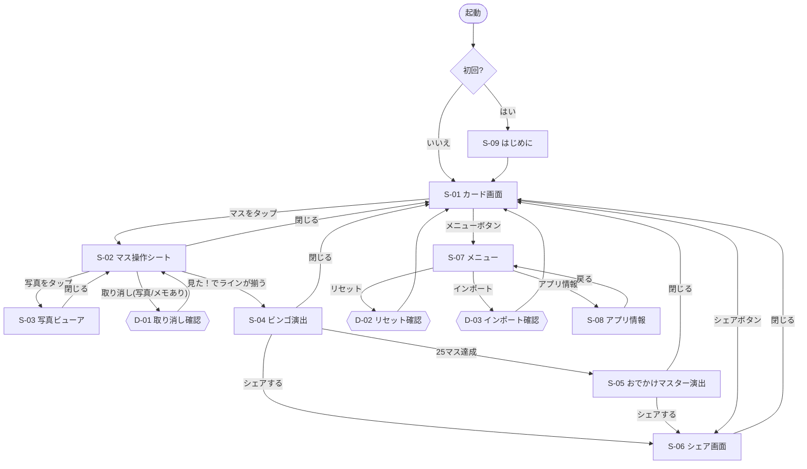
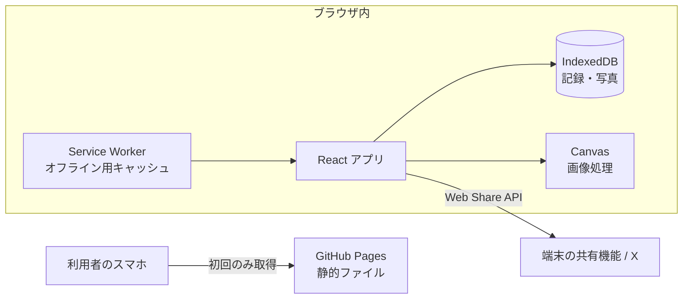

# 基本設計書 — トコトコおでかけビンゴ帳（非公式）

| 項目 | 内容 |
|---|---|
| 版 | 0.1（2026-11-22 承認済み） |
| 作成日 | 2026-11-22 |
| 工程 | 2. 基本設計（ウォーターフォール） |
| 入力 | [要件定義書 v0.2](01_requirements.md)（承認済み） |
| 次工程 | 本書の承認後に詳細設計（docs/03_detailed_design.md）へ進む |

---

## 1. 要件定義の未決事項の決定

| 未決事項 | 決定（案） | 理由 |
|---|---|---|
| アプリ名 | **トコトコおでかけビンゴ帳（非公式）**（ホーム画面での短縮名：おでかけビンゴ帳） | 公式の企画名と区別でき、「非公式」が名前に入る（C-02） |
| シェア投稿文にアプリの URL を入れるか | **入れない** | 当面は実質的な限定公開のため。一般公開するときに再検討する |

---

## 2. 画面一覧

| ID | 画面 | 種別 | 概要 | 主な要件 |
|---|---|---|---|---|
| S-01 | カード画面 | メイン画面 | 公式カード画像と達成状態、ビンゴ数、達成数を表示する。アプリの起点 | FR-01, 02, 07 |
| S-02 | マス操作シート | 下から出るシート | タップしたマスの記録の確認と、スタンプ・写真・メモ・取り消しの操作 | FR-03〜06 |
| S-03 | 写真ビューア | 全画面 | マスの写真を大きく表示する | FR-04 |
| S-04 | ビンゴ演出 | 重ね表示 | 新しく揃ったラインを光らせ「うれしい！」を出す | FR-08 |
| S-05 | おでかけマスター演出 | 重ね表示 | 25 マス達成時の特別演出 | FR-09 |
| S-06 | シェア画面 | 全画面 | シェア画像の種類選択、プレビュー、投稿文の確認、共有 | FR-10〜12 |
| S-07 | メニュー | 下から出るシート | エクスポート、インポート、リセット、表示切替、アプリ情報への入口 | FR-13〜15, C-05 |
| S-08 | アプリ情報 | 全画面 | 非公式である旨、出典、ガイドラインへのリンク、遊ぶ際の注意 | FR-16 |
| S-09 | はじめに | 重ね表示 | 初回起動時に 1 度だけ出す。非公式である旨、遊び方、「人の迷惑にならないよう」の注意 | FR-16, C-02 |

| ID | ダイアログ | 表示条件 |
|---|---|---|
| D-01 | 取り消し確認 | 写真またはメモがあるマスを取り消すとき（FR-06） |
| D-02 | リセット確認（2 段階） | リセット実行時。1 段階目で内容を説明し、2 段階目で「リセット」と書かれたボタンを押させる（FR-13） |
| D-03 | インポート確認 | 読み込んだファイルの内容（達成数・写真枚数・エクスポート日時）を示し、置き換えてよいか確認する（FR-15） |
| D-04 | エラー表示 | 保存容量不足、カメラ・写真へのアクセス拒否、ファイル形式不正、共有失敗 |

> S-09（はじめに）は要件定義書にない追加画面です。C-02（公式誤認の防止）と公式の注意書きを、最初に確実に見てもらうために設けます。

---

## 3. 画面遷移



- ブラウザの「戻る」操作（Android の戻るボタンを含む）で、シートや全画面を閉じて 1 つ前に戻れるようにする。
- URL は 1 つだけにし、画面の状態は URL に持たない。データは端末内にしかないため、URL を共有しても意味がない。

---

## 4. ワイヤーフレーム

スマホの縦画面（幅 375pt 程度）を基準とする。PC では中央に最大幅 480pt で表示する。

### S-01 カード画面
```
┌─────────────────────────────┐
│ おでかけビンゴ帳（非公式）      ⋯ │ ← ⋯ = メニュー(S-07)
├─────────────────────────────┤
│   🎉 3 ビンゴ   ✅ 12 / 25     │ ← 常時表示（FR-07）
├─────────────────────────────┤
│ ┌─────────────────────────┐ │
│ │  公式ビンゴカード画像         │ │
│ │ ┌───┬───┬───┬───┬───┐ │ │
│ │ │見た│   │   │見た│   │ │ │ ← 達成マスに「見た!!!」スタンプ
│ │ ├───┼───┼───┼───┼───┤ │ │
│ │ │   │見た│   │   │📷 │ │ │ ← 写真ありは隅にサムネイル
│ │ ├───┼───┼───┼───┼───┤ │ │
│ │ │   │   │見た│   │   │ │ │ ← 中央は最初から達成(FREE)
│ │ ├───┼───┼───┼───┼───┤ │ │
│ │ │   │   │   │見た│   │ │ │
│ │ ├───┼───┼───┼───┼───┤ │ │
│ │ │   │   │   │   │見た│ │ │
│ │ └───┴───┴───┴───┴───┘ │ │
│ └─────────────────────────┘ │
│                             │
├─────────────────────────────┤
│  [ 📤 シェアする ]              │ ← 親指が届く下部に固定
└─────────────────────────────┘
```
- カード画像は画面幅いっぱいに表示する。1 マスはおよそ 65pt 四方になり、NFR-04（44pt 以上）を満たす。
- 揃ったラインは、カード上で薄く色を付けて常時わかるようにする。

### S-02 マス操作シート（未達成のマス）
```
├─────────────────────────────┤ ← 画面の下 半分程度
│            ───               │ ← 下にスワイプで閉じる
│  🐼 パンダのスプリング遊具        │
│  まだ見つけていません            │
│                             │
│  ┌───────────────────────┐ │
│  │   ✋ 見た！（スタンプ）        │ │ ← いちばん大きいボタン
│  └───────────────────────┘ │
│  [ 📷 写真を撮って見た！ ]        │
│  [ 🖼 写真を選んで見た！ ]        │
└─────────────────────────────┘
```

### S-02 マス操作シート（達成済みのマス）
```
├─────────────────────────────┤
│            ───               │
│  🐼 パンダのスプリング遊具   見た!!! │
│  2026/11/23 14:05 に見つけた    │
│  ┌──────┐                   │
│  │ 写真  │ ← タップでS-03         │
│  └──────┘                   │
│  メモ：[ 公園で発見！        ✎ ] │ ← 100文字まで
│                             │
│  [ 📷 写真を変更 ]  [ 🗑 取り消し ] │
└─────────────────────────────┘
```
- 写真のないマスでは「写真を撮る」「写真を選ぶ」ボタンを出す。
- 中央（FREE）マスでは取り消しボタンを出さず、「出発したら達成！」と表示する。写真やメモは付けられる。

### S-04 ビンゴ演出
```
┌─────────────────────────────┐
│                             │
│   （揃ったラインがキラキラ光る）     │
│                             │
│         うれしい！             │
│        3 ビンゴ目！            │
│                             │
│  [ 📤 シェアする ]  [ 閉じる ]    │
└─────────────────────────────┘
```
- 1 回の操作で 2 ライン同時に揃った場合も、演出は 1 回にまとめる。
- 取り消し後にもう一度揃えた場合も演出を出す。

### S-06 シェア画面
```
┌─────────────────────────────┐
│ ←  シェア                       │
├─────────────────────────────┤
│  ( カード )  ( 写真入り )        │ ← 種類の切替(FR-10/11)
│  ┌───────────────────────┐ │
│  │                         │ │
│  │   シェア画像のプレビュー        │ │
│  │                         │ │
│  └───────────────────────┘ │
│  投稿文：                       │
│  ┌───────────────────────┐ │
│  │トコトコおでかけビンゴ 3ビンゴ！ │ │ ← 編集できる
│  │（12/25マス）                │ │
│  │#さなちゃんねるトコトコおでかけビンゴ│ │
│  └───────────────────────┘ │
│  [ 📤 シェアする ]                │ ← Web Share API
│  [ 💾 画像を保存 ] [ 𝕏 で投稿 ]   │ ← Web Share非対応時の代替
└─────────────────────────────┘
```
- Web Share API で画像を共有できる環境では「シェアする」を主ボタンにする。できない環境では「画像を保存」と「X で投稿」を主ボタンにする。
- 「X で投稿」は投稿文だけを入れた投稿画面を開く。画像は保存したものを利用者が添付する（X の投稿画面の URL では画像を渡せないため）。

### S-07 メニュー
```
├─────────────────────────────┤
│  💾 データを書き出す（エクスポート）  │
│  📂 データを読み込む（インポート）    │
│  🎨 カードの表示：公式画像 / 文字   │ ← C-05 の切替
│  ℹ️ このアプリについて            │
│  ⚠️ カードをリセット             │ ← 赤字・いちばん下
└─────────────────────────────┘
```

### S-08 アプリ情報（記載内容）
- 本アプリは名取さなさん・公式運営とは関係のない、ファンによる非公式・非営利の制作物であること
- お題・カード画像・スタンプ画像の出典（公式 X の投稿へのリンク）
- 名取さな 二次創作ガイドラインへのリンク
- 公式への問い合わせはしないでほしいこと
- 「激カワビンゴに夢中になり、人の迷惑にならないよう」（公式の注意書きを要約して掲載）
- データは端末内にだけ保存され、外部に送られないこと。機種変更前にエクスポートしてほしいこと
- バージョンとソースコード（GitHub）へのリンク

---

## 5. データ項目

すべて端末内（IndexedDB）に保存する。

### 5.1 マスの記録（25 件）
| 項目 | 内容 | 必須 |
|---|---|---|
| マス ID | `r1c1`〜`r5c5` | ○ |
| 達成状態 | 達成 / 未達成 | ○ |
| 達成日時 | 「見た！」を押した日時。取り消すと消える | 達成時 ○ |
| 写真 | 縮小済み JPEG（長辺 1280px、EXIF なし） | — |
| サムネイル | 写真から作る小さい画像（長辺 240px）。カード表示とシェア画像に使う | 写真あり時 ○ |
| メモ | 100 文字まで | — |

- 中央マス（`r3c3`）は初期状態から達成とする。達成日時は初回起動の日時にする。

### 5.2 アプリの設定と状態
| 項目 | 内容 |
|---|---|
| カードの表示方式 | 公式画像 / 文字（C-05） |
| はじめにを見たか | S-09 を 1 度だけ出すためのフラグ |
| 演出済みのライン | 演出を出したラインの一覧。新しく揃ったラインだけを演出するため |
| データ形式のバージョン | 将来、形式を変えたときの移行用 |

### 5.3 お題データ（アプリに同梱、利用者は変更しない）
| 項目 | 内容 |
|---|---|
| マス ID | `r1c1`〜`r5c5` |
| お題名 | 3 章の表記 |
| 絵文字 | 付録 A |
| 補足説明 | トマソンの説明など（任意） |
| 画像上の位置 | 公式カード画像（1500×1500px）上のマスの矩形。詳細設計で実測して定義する |

### 5.4 エクスポートファイル
- 形式：zip、ファイル名 `odekake-bingo-YYYYMMDD.zip`
- 中身：記録（5.1 と 5.2）の JSON、および写真ファイル
- 中身の詳しい形式は詳細設計で定義する

---

## 6. シェア画像のレイアウト

どちらも X で見やすい 1080×1350px（縦 4:5）の PNG とする。

### 6.1 カード版（FR-10）
```
┌──────────────── 1080 ────────────────┐
│ トコトコおでかけビンゴ                    │ 120
│ 🎉 3 ビンゴ  ✅ 12/25                   │
├──────────────────────────────────────┤
│                                      │
│   公式カード画像（1080×1080）             │ 1080
│   ＋ 達成マスに「見た!!!」スタンプ           │
│   ＋ 揃ったラインのハイライト                │
│                                      │
├──────────────────────────────────────┤
│ #さなちゃんねるトコトコおでかけビンゴ          │ 150
│ 非公式ファンツール「おでかけビンゴ帳」で作成      │
└──────────────────────────────────────┘
```

### 6.2 写真入り版（FR-11）
```
┌──────────────── 1080 ────────────────┐
│ トコトコおでかけビンゴ  🎉3ビンゴ ✅12/25   │ 120
├──────────────────────────────────────┤
│ ┌────┬────┬────┬────┬────┐          │
│ │写真 │公式│写真 │写真 │公式│          │ ← 5×5、1マス約200px
│ │    │+見た│    │    │    │          │   写真があれば写真
│ ├────┼────┼────┼────┼────┤          │   なければ公式画像の
│ │ … │                              │   そのマス（達成なら
│ └────┴────┴────┴────┴────┘          │   スタンプ付き）
│ （各マスの下に小さくお題名）                │ 1080
├──────────────────────────────────────┤
│ #さなちゃんねるトコトコおでかけビンゴ          │ 150
│ 非公式ファンツール「おでかけビンゴ帳」で作成      │
└──────────────────────────────────────┘
```
- 写真は正方形に中央で切り抜く。
- 未達成のマスは公式画像のマスを薄く（グレーがかった）表示し、達成マスと区別する。

### 6.3 C-05 の代替表示時
公式画像の代わりに、文字と絵文字のマスとオリジナルの印で同じレイアウトを描く。

---

## 7. デザイン方針

### 7.1 参照元
名取さな公式サイト（https://natorisana.com 、2026-11-22 時点）の雰囲気を参照する。公式サイトから読み取った特徴は次のとおり。

| 要素 | 公式サイトの特徴 |
|---|---|
| アクセント色 | コーラルピンク `#FF8484`（ロゴ、フッターの区切り線、コピーライト） |
| 文字色 | 濃い紫紺 `#3C3557`（黒ではない） |
| 背景 | 外側はライトグレー `#D8D8D8`。イラスト部分はラベンダーから水色へのグラデーション、白、青灰の線画 |
| 文字 | 本文は IBM Plex Sans JP。ロゴやナビゲーションは太く丸い欧文の大文字 |
| 線と形 | 太めの青灰の輪郭線、フラットな塗り、影なし、角ばった等角図の部屋のイラスト |
| 印象 | やわらかいパステル、余白が多い、情報は最小限 |

### 7.2 本アプリのデザイン
公式の「色と質感」は借りるが、「ロゴ・イラスト・レイアウト」は真似しない。公式サイトの一部や公式アプリと誤解されないようにするため（C-02）。

| 項目 | 方針 |
|---|---|
| 配色 | アクセント（ボタン、ビンゴ数、揃ったラインの光）：コーラルピンク `#FF8484`。文字：紫紺 `#3C3557`。画面の背景：ラベンダー `#E9E4FA` から水色 `#E3F1FC` への淡いグラデーション。カードやシートの面：白 `#FFFFFF`。枠線：青灰 `#8A9CC4`。正確な値とコントラストの確認は詳細設計で行う |
| 文字 | 本文は IBM Plex Sans JP（Google Fonts。オフライン用にアプリに同梱する）。見出しと数字（「3 ビンゴ」「12/25」）は丸みのある太字（M PLUS Rounded 1c の Bold など）で、公式ロゴのやわらかい印象に寄せる |
| 線と形 | カード・シート・ボタンは白地に青灰の 2px 程度の輪郭線、角丸、影なしのフラットな見た目にする |
| アイコン | 公式のうさぎマークやロゴは使わない。アプリのアイコンは、コーラルピンクの地に白い「ビンゴの丸」を描いたオリジナルにする |
| ダークモード | 対応しない。公式カード画像と公式サイトの明るい雰囲気に合わせ、明るい配色に固定する |
| 演出 | 動きは控えめにし、端末の「視差効果を減らす」設定が有効なら光る演出を省く |
| 公式誤認対策 | 画面上部のアプリ名に常に「（非公式）」を表示する。公式サイトのロゴ書体や「natorisana.com」風の表記は使わない |

---

## 8. エラー時の振る舞い

| 状況 | 振る舞い |
|---|---|
| 端末の保存容量が足りない | 写真の保存を中止し、「写真を保存できませんでした。容量を空けるか、写真なしで記録してください」と表示する。スタンプのみの記録は続けられる |
| カメラ・写真へのアクセスが拒否された | 端末の設定で許可する方法を案内する。スタンプのみの記録は続けられる |
| インポートしたファイルの形式が不正 | 読み込みを中止し、今のデータは変更しない |
| 共有がキャンセル・失敗した | キャンセルは何も表示しない。失敗時は「画像を保存」での代替を案内する |
| ブラウザがデータを消す可能性 | 初回に永続保存（Persistent Storage）を要求する。S-08 でエクスポートを勧める |

---

## 9. 技術構成の概要

| 区分 | 採用 |
|---|---|
| 言語・フレームワーク | TypeScript、React、Vite |
| PWA | vite-plugin-pwa（Service Worker でアプリ本体と画像をキャッシュ） |
| 保存 | IndexedDB（idb ライブラリ） |
| 画像処理 | Canvas（写真の縮小と EXIF 除去、シェア画像の生成） |
| zip | fflate |
| テスト | Vitest（単体）、Playwright（E2E、モバイル表示） |
| 公開 | GitHub Actions で build し GitHub Pages に配置 |


